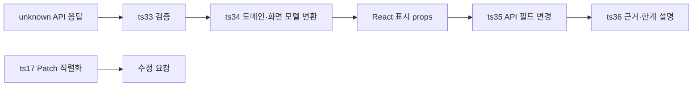

# TypeScript 과정 재구성안

- 작성일: 2026-09-11
- 기준: `docs/superpowers/specs/2026-09-11-fullstack-curriculum-harness-design.md`, `docs/curriculum/2026-09-11-typescript-harness-evaluation.md`, 현재 `src/curriculum/*.ts`
- 참고: 사용자가 제공한 《타입스크립트 교과서》(조현영) 목차. 목차는 개념 의존성과 누락 확인에만 사용하며, 책의 순서·분량·라이브러리 분석 챕터를 과정에 복제하지 않는다.
- 이 문서는 재구성 설계안이다. 레슨 데이터·앱·검사기는 수정하지 않는다.

## 1. 대상과 도착점

대상은 JavaScript의 함수·객체·배열·모듈과 React 컴포넌트의 기본 사용을 알고, TypeScript의 별칭·인터페이스·기본 함수 표기를 접한 wavy다. 이미 아는 문법을 처음부터 반복하지 않고 네 개의 진단으로 현재 수준을 확인한다.

과정 종료 시 학습자는 다음을 할 수 있어야 한다.

1. API·저장소·사용자 입력을 `unknown`으로 받아 실제 값 검증 후 앱 모델로 변환한다.
2. 모델·함수·수정 요청·모듈의 타입 관계를 제네릭, 유니온, 유틸리티 타입과 좁히기로 표현한다.
3. `strict` 설정과 모듈·선언 파일 경계에서 발생한 오류를 읽고, 타입 선언의 보장 범위와 런타임 검증의 차이를 설명한다.
4. React·Node·HTTP 과정이 사용할 타입 계약을 전달하고, 변경된 API가 화면까지 번지지 않도록 변환 경계를 고친다.
5. 설계 판단이 필요한 지점에서 선택한 타입 표현, 대안, 한계, 실패 입력과 검증 방법을 짧고 논리적으로 설명한다.

핵심 수료 증거는 작은 실습의 코드 통과만으로 만들지 않는다. 단계 체크포인트와 과정 종합 실습에서 `이론 이해`, `적용 능력`, `논리적 설명`을 각각 한 번 이상 확인한다. 반대로 기본 문법 레슨마다 긴 서술형 답변을 요구하지 않는다.

## 2. 책 대비 범위 결정표

| 책의 범위 | 이 과정의 결정 | 이유와 과정 소유권 |
| --- | --- | --- |
| 타입 추론, 리터럴, 튜플 | core | 기본 타입 관계를 읽고 `as const`·튜플의 고정 순서를 사용할 수 있어야 이후 계약을 오해하지 않는다. |
| `any`, `unknown`, `void`, `never` | core | `any`의 정보 손실, 외부 경계의 `unknown`, 반환 불가/종료 흐름을 구분한다. |
| 타입 별칭, 인터페이스, 선언 병합 | 별칭·인터페이스는 core, 선언 병합은 module/`.d.ts` 심화 | 앱 모델은 core다. 선언 병합은 전역·라이브러리 보강처럼 필요한 선언 파일 상황에서만 다룬다. |
| 네임스페이스 | handoff | 현대 모듈 시스템을 우선한다. 기존 전역 선언을 읽어야 할 때 `.d.ts` 레슨에서 짧게 다룬다. |
| 인덱스 접근, 매핑 타입 | 인덱스 접근은 core, 매핑은 core 기초·심화 확장 | `T[K]`는 제네릭 계약에 직접 필요하다. 키 재매핑은 선택 심화다. |
| 유니언, 인터섹션, 좁히기 | core | 요청 상태, API 결과, React 액션의 안전한 분기에 필요하다. |
| 구조적 타이핑·초과 속성 검사 | core | TypeScript의 대입 가능성과 외부 입력 검증의 차이를 이해해야 한다. |
| 제네릭·제약 | core | 재사용 함수, 페이지 응답, 키-값 관계에 필요하다. |
| 조건부 타입 | core 기초 | 요청 모양과 응답 관계처럼 작은 계산까지만 핵심으로 둔다. 분산 규칙은 심화다. |
| `infer`, 분산 조건부 타입 | optional | 라이브러리 타입을 읽고 제한적으로 작성하는 심화 능력이다. |
| 함수, 콜백, 오버로드, 공변성·반공변성 | 함수·콜백은 core, 오버로드·variance는 optional | 일상 함수 계약은 필수다. 복잡한 공개 API와 라이브러리 콜백의 경우에만 심화한다. |
| 클래스, 추상 클래스 | 클래스는 core, 추상 클래스는 optional | 클래스가 값이면서 타입인 성질과 `implements`를 이해한다. 추상 계층은 남용하지 않도록 심화로 둔다. |
| `enum` | optional | 읽고 안전하게 쓸 수는 있어야 하지만, 새 앱 모델에는 문자열 유니온·`as const`를 함께 비교해 선택한다. |
| `satisfies` | core | 설정·라우트 값이 필요한 필드를 갖췄는지 검사하면서 각 속성의 구체적인 문자열과 숫자 타입을 유지한다. |
| 브랜드 타입 | optional | ID 혼동이 실제 위험인 경계에서만 사용한다. DB 무결성이나 런타임 검증을 대신하지 않는다. |
| 재귀 타입 | exclude | 현재 도착점의 API·UI·모듈 경계에 별도 실습이 필요한 사용 사례가 없다. 필요가 생기면 라이브러리 타입 심화로 추가한다. |
| 템플릿 리터럴·키 재매핑 | optional | 제한된 이벤트/공개 키 계산을 연습하되 조합 폭발 비용을 함께 다룬다. |
| 데코레이터 | core 기초 + NestJS handoff | TS의 실행 시점·메타데이터 한계를 먼저 익히고, NestJS 데코레이터의 Controller/DI 의미는 NestJS 과정이 소유한다. |
| 유틸리티 타입 | core | `Pick`, `Omit`, `Partial`, `Record`, `Parameters`, `ReturnType`, `Awaited`를 문제에 맞춰 선택한다. |
| `Promise`, `Awaited`, `lib.es5.d.ts` 분석 | Promise·Awaited는 core, 전체 표준 라이브러리 재구현은 optional | 비동기 결과 타입은 경계에 필수다. `map`·`reduce` 전체 타입 재구현은 타입 라이브러리 심화다. |
| `tsc`, `tsconfig`, `strict` | core | 타입 안전의 실제 전제이며, 옵션별 오류·이관 비용을 실행 결과로 확인한다. |
| 스크립트 파일·모듈 파일, JavaScript 생성 | core | 전역 오염과 타입/값 import 경계를 구분한다. 번들·모듈 형식의 세부 선택은 Node/Next 환경에서 이어 간다. |
| jQuery 타입 분석 | exclude | 현재 제품 도착점과 기술 스택에서 직접 필요하지 않다. |
| Axios 타입 분석 | handoff: HTTP·API 과정 | HTTP 응답 계약, 오류, 취소의 의미는 HTTP 과정이 소유한다. TS 과정은 외부 응답의 타입 경계만 전달한다. |
| React 타입 분석 | handoff: React 과정 | props, 상태, 이벤트, Hooks, JSX의 실제 적용은 React 과정이 소유한다. TS 과정은 안전한 모델·유니온·제네릭이라는 선수 능력을 전달한다. |
| Node.js 타입 분석 | handoff: Node.js 과정 | Node 런타임, 이벤트 루프, 환경·스트림의 의미는 Node 과정이 소유한다. TS 과정은 Node 모듈 선언을 읽고 타입/값 경계를 만드는 데까지만 맡는다. |
| Express 타입 분석 | handoff: HTTP·NestJS 과정 | `req`·`res`·`next`와 DTO/권한의 애플리케이션 의미는 HTTP·NestJS가 소유한다. |
| 패키지 직접 타이핑, `.d.ts` 생성, JS→TS 전환 | 소비자 관점 `.d.ts`는 core, 패키지 제작·배포와 전환은 optional/handoff | 타입 없는 의존성을 최소 표면으로 선언해 안전하게 쓰는 능력은 필요하다. 패키지 공개 설계와 대규모 전환은 실제 프로젝트 조건이 생길 때 심화한다. |

## 3. 새 단계 순서

1. **타입 모델의 기초**: 넓어짐과 좁아짐, 모델 선언, 구조적 대입을 먼저 이해한다.
2. **함수와 타입 관계**: 제네릭과 유틸리티 타입으로 입력·출력·키·수정 범위를 연결한다.
3. **런타임 경계와 비동기**: 정적 선언이 검증하지 못하는 외부 값을 실제로 검사하고 실패를 표현한다.
4. **클래스·설정·모듈**: TypeScript가 컴파일러·모듈 환경에서 작동하는 전제를 만든다.
5. **타입 계산 심화**: 필요한 경우에만 조건부·`infer`·문자열 계산을 쓰도록 범위와 비용을 판단한다.
6. **프레임워크 인수인계**: React/Node/HTTP/NestJS에 넘길 타입 계약을 작은 연결 과제로 확인한다. 프레임워크 자체의 사용법을 여기서 다시 가르치지 않는다.
7. **주문 흐름 종합 실습**: 앞 결과물을 하나의 제공 프로젝트에서 재사용하며 API 변경을 흡수한다.

## 4. 정식 실습 36개

표기의 `★`는 SQL Teaching식 **짧은 설명 → 완성 예시와 결과 이유 → 유사 퀴즈**가 잘 맞는 레슨이다. 아키텍처·설명 과제에는 이 표식을 붙이지 않고, 대안 비교와 결정 근거를 쓴다. 숙달 축은 해당 레슨이 만드는 최소 증거이며, 과정 체크포인트와 종합 실습이 세 축을 완성한다.

| # | 임시 ID·이름 | 학습 행동 | 산출물 | 숙달 축 | 현재 실습 처리 |
| ---: | --- | --- | --- | --- | --- |
| 1 | `ts01.inference-literals` ★ 추론과 리터럴 | `const`/`let`, 리터럴 넓어짐, `satisfies`를 비교한다. | 안전한 환경 설정 객체 | 이해·적용 | `d1`과 `t09`를 **merge** |
| 2 | `ts02.tuple-readonly` ★ 튜플과 읽기 전용 | 위치가 정해진 API 결과와 가변 배열을 구분한다. | 좌표/페이지 커서 튜플 타입 | 이해·적용 | **replace** |
| 3 | `ts03.top-bottom-types` ★ `any`·`unknown`·`void`·`never` | 값 사용 가능 범위와 종료 흐름을 비교한다. | 파싱 결과와 exhaustive 분기 | 이해·적용 | `d3` 일부를 **move** |
| 4 | `ts04.models-alias-interface` ★ 별칭·인터페이스 | 앱 모델을 선언하고 확장/조합의 차이를 선택한다. | `Order`와 수정 계약 | 이해·적용 | `g07`, `t10`을 **move/merge** |
| 5 | `ts05.unions-narrowing` ★ 유니언·인터섹션·좁히기 | 판별자와 `in`/`typeof`로 분기한다. | 결제/요청 상태 모델 | 이해·적용 | `d2`, `b17`을 **merge** |
| 6 | `ts06.structural-typing` ★ 구조적 타이핑 | 대입 가능성·초과 속성 검사·런타임 검증의 차이를 설명한다. | 감사 로그 함수 계약 | 이해·설명 | `d4`를 **keep** |
| 7 | `ts07.function-contracts` ★ 함수·콜백 계약 | 매개변수, 반환값, 선택 매개변수와 콜백을 작성한다. | 변환 함수 시그니처 | 이해·적용 | `g02` 일부를 **move** |
| 8 | `ts08.generic-basics` ★ 제네릭 기본 | 배열 입력과 결과 타입을 보존한다. | `first<T>`/`mapItems<T,U>` | 이해·적용 | `g01`, `g03`을 **merge** |
| 9 | `ts09.generic-constraints` ★ 제약·`keyof`·`T[K]` | 필요한 최소 필드와 키-값 관계를 표현한다. | 안전한 필드 선택 함수 | 이해·적용 | `g04`–`g06`을 **merge** |
| 10 | `ts10.generic-models` 제네릭 모델 | 페이지 응답 등 반복 모델을 타입 별칭으로 만든다. | `Page<T>` | 적용 | `g07`을 **move** |
| 11 | `ts11.utility-update-contract` ★ 유틸리티 타입 | `Pick`/`Omit`/`Partial`/`Record`로 수정·설정 범위를 제한한다. | `UpdateProfile`·필드 오류 타입 | 이해·적용 | `t10`, `t11`을 **merge** |
| 12 | `ts12.conditional-response` 조건부 응답 | 요청 모양에 따라 반환 타입을 계산하고 JS 분기와 구분한다. | `SearchResult<T>` | 이해·적용 | `t13`을 **keep** |
| 13 | `ts13.unknown-guard` ★ 외부 값 검증 | `unknown` 객체·속성을 실제로 검사하는 가드를 쓴다. | `isPayment` | 이해·적용 | `b18`, `b19`을 **merge** |
| 14 | `ts14.dto-to-domain` ★ DTO 변환 | 서버 DTO를 화면/도메인 모델로 한 지점에서 바꾼다. | `toOrder` 변환기 | 적용 | `b20`을 **keep** |
| 15 | `ts15.result-failure` 예상 실패 표현 | 성공·실패를 판별 유니온으로 만들어 호출부가 처리하게 한다. | `Result<T,E>` 파서 | 이해·적용 | `b21`을 **keep** |
| 16 | `ts16.async-awaited` ★ Promise·`Awaited` | 비동기 함수의 성공값과 오류 경계를 구분한다. | loader 반환 타입 | 이해·적용 | `t14`를 **replace** |
| 17 | `ts17.patch-json-boundary` JSON 수정 경계 | 생략·`undefined`·`null`의 의도를 구분하고 직렬화한다. | 안전한 `OrderPatch` | 이해·적용 | `p32`, `c34`를 **merge** |
| 18 | `ts18.class-value-type` 클래스의 값·타입 | 클래스가 런타임 값과 타입으로 쓰이는 방식을 `implements`와 함께 확인한다. | `MemoryOrderStore` | 이해·적용 | **replace** |
| 19 | `ts19.abstract-contract` 선택: 추상 클래스 | 공통 구현이 실제로 있을 때만 추상 기반 계약을 선택한다. | 저장소 추상 기반 비교 기록 | 설명·적용 | **replace**, optional |
| 20 | `ts20.decorator-boundary` 데코레이터 기초 | 데코레이터의 실행 시점과 타입 보장 한계를 확인한다. | `out.ts20.decorator-runtime-boundary`: 메서드 호출 기록 데코레이터와 실행/타입 경계 기록 | 이해·설명 | **replace** |
| 21 | `ts21.enum-or-const-object` 선택: enum 비교 | `enum`, 문자열 유니온, `as const` 객체의 런타임 결과와 선택 기준을 비교한다. | 상태 상수 설계 메모 | 설명·적용 | **replace**, optional |
| 22 | `ts22.strict-baseline` ★ `strict` 기준선 | `strict`, `noUncheckedIndexedAccess`, `exactOptionalPropertyTypes`가 찾는 오류를 고친다. | `out.ts22.strict-baseline`: 의도된 `tsconfig`와 오류 수정 | 이해·적용 | `p29` 일부를 **move** |
| 23 | `ts23.function-variance` 선택: variance | `strictFunctionTypes`에서 콜백 매개변수의 안전한 범위를 고친다. | 테이블 `renderRow` 계약 | 이해·설명 | `p29`를 **keep**, optional |
| 24 | `ts24.script-module-boundary` ★ 스크립트·모듈 | 전역 스크립트와 모듈을 구분하고 `import type`를 쓴다. | `out.ts24.module-boundary`: 타입/값 분리 모듈 | 이해·적용 | `p31`을 **merge** |
| 25 | `ts25.declaration-file` ★ 최소 `.d.ts` | 실제 사용하는 패키지 표면만 선언해 오타와 누락을 잡는다. | analytics 모듈 선언 | 이해·적용 | `p30`을 **keep** |
| 26 | `ts26.package-contract` 패키지 타입 계약 | `export =`/ESM 선언을 읽고 소비자 API를 좁힌다. | 작은 패키지 타입 소비 예제 | 적용·설명 | **replace** |
| 27 | `ts27.mapped-errors` 매핑 타입 | 모델 변경을 따라가는 오류 타입을 작성한다. | `FieldErrors<T>` | 적용 | `t11`의 오류 모델 부분을 **move** |
| 28 | `ts28.infer-and-distribution` 선택: `infer`·분산 | 함수/유니온 구조에서 타입을 꺼내고 분산을 막는 경우를 예상한다. | `PayloadOf`/`IsAllPayload` | 이해·적용 | `t14`, `t15`를 **merge**, optional |
| 29 | `ts29.template-key-remap` 선택: 문자열 계산 | 제한된 키 재매핑·템플릿 타입의 이득과 조합 비용을 설명한다. | 이벤트/공개 메트릭 타입 | 설명·적용 | `t12`, `t16`을 **merge**, optional |
| 30 | `ts30.brand-at-boundary` 선택: 브랜드 ID | 실제 검증된 ID만 브랜드로 구분하고 한계를 설명한다. | `OrderId` 변환기 | 이해·설명 | `b22`를 **keep**, optional |
| 31 | `ts31.framework-contract-handoff` 프레임워크 계약 인수인계 | React props·이벤트와 NestJS가 소비할 DTO 모듈을 타입 전용 import와 값 import로 분리해 제공한다. | `out.ts31.framework-contract-handoff`: `OrderViewProps`·`OrderAction`·`CreateOrderDto`·`UpdateOrderDto` 모듈 | 적용 | `r23`–`r28`을 **move**하여 React 과정 소유로 전환; 이 레슨은 React·NestJS 전달 계약만 **replace** |
| 32 | `ts32.node-module-handoff` Node·HTTP 계약 인수인계 | Node 모듈 타입과 HTTP 응답 모델의 경계를 읽어 다음 과정에 전달한다. | `fetchOrders` 포트 인터페이스 | 이해·적용 | **replace** |
| 33 | `ts33.capstone-validate` 주문 API 검증 | 제공 프로젝트의 `unknown` API 응답을 검증한다. | `out.ts33.order-runtime-validation`: `parseApiOrder` | 적용 | `c33`을 **keep** |
| 34 | `ts34.capstone-map-display` 주문 모델·화면 전달 | 검증된 API 모델을 화면 모델로 바꾸고 React 화면에 전달한다. | `OrderViewModel`·표시 props | 적용 | `b20`, `c36`, `r24`를 **merge** |
| 35 | `ts35.capstone-change` API 변경 흡수 | `quantity`→`units` 변경을 변환 경계에서 처리하고 기존 화면을 보호한다. | 버전 호환 변환기·회귀 사례 | 적용·설명 | `c36`을 **move/merge** |
| 36 | `ts36.capstone-decision` 경계 설계 설명 | 타입 선언, 런타임 검증, Patch 의도, React/NestJS 책임을 근거로 설명한다. | `out.ts36.nest-boundary-decision`: 짧은 설계 답변·실패 사례·NestJS handoff 체크 | 이해·설명 | `c34`, `c35`를 **merge/replace** |

핵심은 30개(`ts01`–`ts18`, `ts20`, `ts22`, `ts24`–`ts27`, `ts31`–`ts36`)이며, 선택 심화는 6개(`ts19`, `ts21`, `ts23`, `ts28`–`ts30`)다. `ts11`과 `ts27`은 현재 `t11`이 두 목적을 섞고 있으므로 분리한다. `ts31`은 React 사용법 레슨이 아니라 TypeScript 과정이 React 과정에 넘기는 계약 확인이다.

## 5. 진단 4개와 복습 연결

진단은 선택 장식이 아니라 시작 위치를 정하는 장치다. 진단 미통과는 수료 실패가 아니며, 해당 복습 output을 마친 뒤 같은 진단 또는 동등한 짧은 과제로 다시 확인한다.

| 진단 | 확인하는 능력 | 통과 시 | 미통과 시 복습 output |
| --- | --- | --- | --- |
| `d1` const/let 추론 | 리터럴 넓어짐·허용 값 | `ts01`의 압축 경로 | `ts01.inference-literals` |
| `d2` 판별 유니온 | 분기와 속성 접근 | `ts05`의 압축 경로 | `ts05.unions-narrowing` |
| `d3` unknown 타입 가드 | 외부 값의 실제 검증 | `ts13`의 압축 경로 | `ts03.top-bottom-types` → `ts13.unknown-guard` |
| `d4` 구조적 타이핑 | 대입 가능성·초과 속성·검증 범위 | `ts06`의 압축 경로 | `ts06.structural-typing` |

진단 결과는 이후 레슨을 건너뛰게 하는 선언이 아니다. 이미 통과한 개념의 설명을 줄이고, 통합 과제에서 다시 적용하게 하는 근거다.

## 6. 과정 종합 실습: 주문 변경을 경계에서 흡수하기

`ts33`–`ts36`은 지금처럼 독립 starter 네 개가 아니라 하나의 제공 프로젝트와 이어진 파일을 사용한다.

정상 결과는 유효한 주문이 화면 모델로 표시되고 수정 요청에서 의도하지 않은 키가 사라지는 것이다. 실패 결과는 `null`, 잘못된 `id`, 범위를 벗어난 수량, 알 수 없는 필드 변경이 명시적 오류가 되는 것이다. 경계 결과는 API가 `quantity` 대신 `units`를 보내도 변환기 한 곳의 변경으로 이전 화면 계약을 유지하는 것이다.

`ts36`의 설명 평가는 다음 다섯 항목을 짧게 본다: 결론, 현재 코드 근거, 가능한 대안, 타입이 보장하지 않는 범위, 실패 입력과 검증 방법. NestJS의 Controller·DTO·데코레이터 의미는 여기서 재교육하지 않고 다음 과정의 handoff로 남긴다.

### 6.1 NestJS 인수인계 계약

이 계약은 TypeScript 과정이 NestJS 과정에서 가르칠 애플리케이션 구조를 미리 구현한다는 뜻이 아니다. TypeScript 과정은 NestJS가 안전하게 시작하기 위한 타입·런타임 경계의 결과물을 전달하고, NestJS 과정은 이를 Controller·DI·DTO 파이프라인·권한 규칙에 적용한다.

| 계약 항목 | 내용 |
| --- | --- |
| handoff ID | `handoff.typescript-nestjs-boundary` |
| from / to | `course.typescript` → `course.nestjs` |
| TypeScript 제공 capability IDs | `ts.class-runtime-type`(클래스는 값이면서 타입), `ts.decorator-runtime-boundary`(데코레이터는 실행 코드이며 타입 검증이 아님), `ts.strict-configuration`, `ts.module-runtime-boundary`, `ts.dto-runtime-validation` |
| NestJS가 소비하는 capability IDs | `ts.class-runtime-type`, `ts.decorator-runtime-boundary`, `ts.strict-configuration`, `ts.module-runtime-boundary`, `ts.dto-runtime-validation` |
| NestJS 과정이 새로 소유하는 capability IDs | `nest.controller-route-contract`, `nest.di-provider-architecture`, `nest.dto-validation-pipeline`, `nest.authorization-boundary` |
| transferred output IDs | `out.ts20.decorator-runtime-boundary`, `out.ts22.strict-baseline`, `out.ts24.module-boundary`, `out.ts31.framework-contract-handoff`, `out.ts33.order-runtime-validation`, `out.ts36.nest-boundary-decision` |
| 버전 조건 | `course.typescript@1.0.0` 이상에서 생성한 output을 `course.nestjs@1.0.0`이 소비한다. output의 DTO 필드·정상/실패 조건·모듈 형식 의미가 바뀌면 새 output ID 또는 SemVer 상향과 함께 handoff를 재검증한다. |
| 재검증 조건 | TypeScript 컴파일러·데코레이터 설정·모듈 해석 정책이 변경되거나, NestJS의 주요 버전·DTO 검증 파이프라인·Controller/DI 사용 방식이 변경되거나, API DTO 계약이 변경될 때 재검증한다. |
| 성공 판정 | NestJS 시작 과제에서 `CreateOrderDto`/`UpdateOrderDto`를 모듈 경계에 맞게 가져오고, Controller 데코레이터만으로 요청 값이 검증된다고 주장하지 않으며, `unknown` 요청을 검증 파이프라인과 도메인 변환으로 처리한다. `strict` 빌드와 정상·잘못된 DTO·변경 DTO 사례가 모두 통과해야 한다. |

`ts20`은 NestJS 데코레이터를 암기시키지 않고, 데코레이터가 실행되는 위치와 타입 검사만으로 입력을 안전하게 만들 수 없는 이유를 전달한다. `ts31`은 React와 NestJS가 공유할 계약을 타입 전용 모듈로 내보내며, 도메인 규칙을 프런트엔드나 공유 DTO에 넣지 않는다. `ts36`은 이 배치를 설명하고, 검증 실패와 계약 변경의 재검증 근거를 남긴다.

## 7. 36개가 적절한 근거

36개는 목표 숫자가 아니라 다음 연습 단위의 합이다.

| 영역 | core | optional | 합계 | 필요한 이유 |
| --- | ---: | ---: | ---: | --- |
| 타입 모델·대입·좁히기 | 6 | 0 | 6 | 이후 모든 타입 읽기와 외부 경계의 언어를 만든다. |
| 함수·제네릭·유틸리티 | 5 | 0 | 5 | 재사용 계약과 수정 범위를 반복 적용한다. |
| 런타임 경계·비동기 | 6 | 1 | 7 | 정적 타입과 실제 값 검증을 분리하고 실패를 다룬다. |
| 클래스·설정·모듈 | 6 | 3 | 9 | 현재 누락된 클래스·데코레이터·strict와 패키지 경계를 보완한다. |
| 타입 계산 심화 | 1 | 2 | 3 | 필요한 계산은 쓰되 고급 문법이 초반을 점유하지 않게 한다. |
| 프레임워크 handoff·종합 | 6 | 0 | 6 | React/Node/HTTP 계약과 변경 전이를 실제 결과물로 연결한다. |
| 합계 | 30 | 6 | 36 | 하네스 평가 권고 범위인 core 30~32 + optional 5~7 안에 든다. |

이 구성이 현재보다 나은 이유는 고급 타입 계산 8개가 첫 16개를 차지하던 편중을 해소하고, 누락된 `strict`, 클래스, 데코레이터, 모듈 환경과 실제 결과물 전이를 넣기 때문이다. 선택 심화는 핵심 경로를 막지 않으며, 실제 라이브러리 타입·공개 API·ID 혼동 문제가 있을 때만 승격한다.

## 8. 구현 순서

1. 이 문서를 기준으로 TypeScript 과정 manifest에 capability, core/optional 분류, 선수 관계, handoff를 정의한다.
2. `d1`–`d4`에 remediation output과 재확인 상태를 연결한다.
3. `ts01`–`ts18`의 starter·solution·정상/실패/경계 fixture를 먼저 만든다. `★` 레슨에는 설명→예시→유사 퀴즈 구조를 적용한다.
4. `ts18`–`ts26`에서 클래스·데코레이터·strict·모듈·선언 파일을 추가하고, 선택 심화 6개를 핵심 수료에서 분리한다.
5. React 레슨(`r23`–`r28`)은 React 과정으로 옮기고, TS 과정에는 `ts31`의 계약 handoff만 남긴다. Node/HTTP/NestJS 과정에도 각각 필요한 capability와 output을 등록한다.
6. `ts33`–`ts36`을 하나의 제공 프로젝트로 만들어 API 검증→변환→표시→변경→설명 evidence chain을 연결한다.
7. 각 core capability에 이해·적용·설명 증거, output의 정상·실패·경계 기대값, 전문 리뷰 policy와 독립 verifier를 추가한다.
8. 구현과 리뷰가 분리된 상태에서 하네스를 다시 평가하고, 누락·중복·진단 복습·handoff·36개 분류가 모두 연결된 뒤에만 `practicePlan.decision`을 `approved`로 바꾼다.
