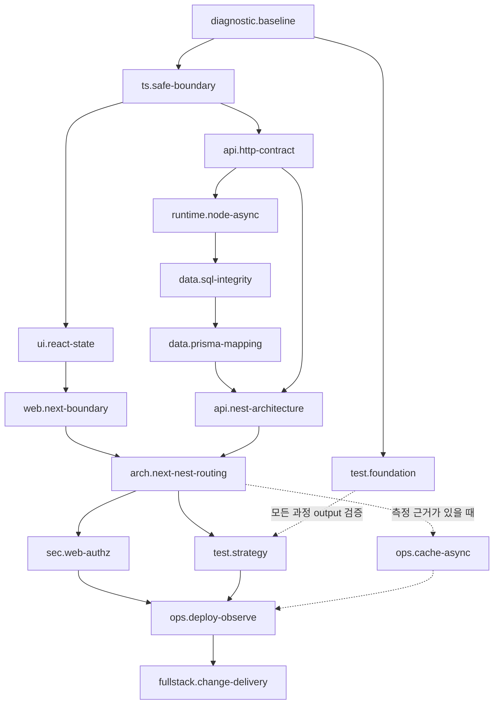
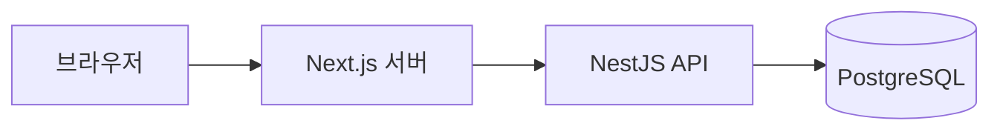
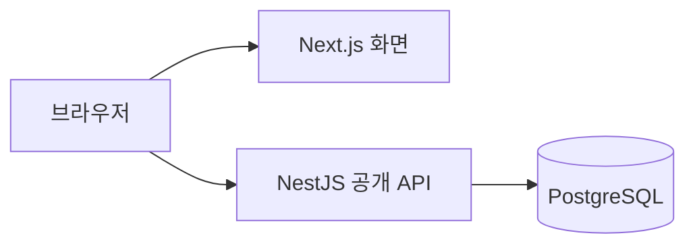
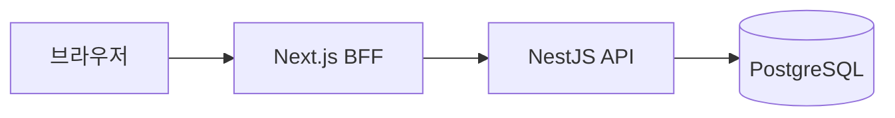

# tiny-dev-lab 풀스택 커리큘럼 하네스 설계

- 상태: 설계 확정안
- 작성일: 2026-09-11
- 범위: 전체 커리큘럼의 목표, 능력 지도, 과정 간 계약, 검증 및 전문 에이전트 운영
- 제외 범위: 개별 과정의 레슨 집필, 앱 코드 변경, 검사기 구현 계획, 기술별 정확한 실습 수 확정

## 1. 이 문서가 해결하는 문제

tiny-dev-lab은 프론트엔드 중심의 Node.js 풀스택 웹 개발자로 계속 성장하기 위해 필요한 이론을 이해하고, 실제 문제에 적용하고, 선택의 이유와 한계를 논리적으로 설명할 수 있게 하는 개인 학습 환경이다.

따라서 전체 도착점에서 필요한 능력이 빠지지 않았는지, 각 과정이 무엇을 책임지는지, 앞 과정의 결과가 다음 과정의 선수 능력이 되는지, 실제 output과 검증 증거가 수료 목표를 입증하는지를 함께 검사해야 한다. 기술 이름을 나열하거나 예제 코드를 한 번 따라 치는 서비스가 아니다. 개별 레슨의 문장 품질만 검사해서는 충분하지 않다.

이 문서에서 **커리큘럼 하네스**는 이 구조를 기록하고 자동 검사와 전문 에이전트 검토로 품질을 반복 확인하는 체계를 뜻한다.

## 2. 제품 목표와 경계

### 2.1 제품 목표

> wavy가 프론트엔드 중심의 Node.js 풀스택 웹 개발자로서 웹 서비스를 설계하고 구현하며, 사용한 기술의 작동 원리, 선택 이유, 대안, 한계와 실패 대응을 논리적으로 설명하고 새로운 요구사항에도 같은 원리를 적용할 수 있게 한다.

학습 무게중심은 프론트엔드에 둔다. 동시에 HTTP, Node.js, 관계형 데이터베이스, 백엔드 구조, 인증, 테스트, 배포와 운영을 직접 다뤄 균형형 풀스택 역할까지 확장할 기반을 만든다.

참고로 wavy의 출발점은 TypeScript의 타입 별칭·인터페이스·기본 함수 타입 표기를 알고 React와 Express로 풀스택 기능을 구현해 본 상태이다.

다만 이 경험은 숙달 판정이 아니라 진단에서 확인할 관찰 근거이므로 이미 안다고 선언해 과정을 생략하거나, 반대로 초급자로 가정해 전부 반복하지 않는다.

과정 이수 후 이직용 프로젝트를 기획하고 완수할 수는 있다. 그러나 특정 채용 공고나 포트폴리오 프로젝트 완성이 tiny-dev-lab 자체의 목적은 아니다. 이직용 프로젝트는 누적된 역량을 증명하는 가능한 결과 중 하나이며, 커리큘럼의 범위와 기술 선택을 지배하지 않는다.

### 2.2 참고 서비스에서 가져오는 원칙

SQL Teaching에서는 설명, 코드 작성, 실행, 실제 결과와 기대 결과 비교가 한 흐름으로 이어진다. tiny-dev-lab은 이 빠른 피드백 구조를 참고한다.

가능한 학습 단위에는 다음 흐름을 적용한다.

1. 핵심 개념을 짧고 정확하게 설명한다.
2. 그 개념이 적용된 완성 예시를 보여주고, 실행 결과가 나온 이유를 설명한다.
3. 같은 원리를 새로운 입력이나 요구사항에 적용하는 유사 퀴즈를 제시한다.
4. 예시를 그대로 복사했는지가 아니라 원리를 다른 상황에 옮겨 쓸 수 있는지를 확인한다.

SQL Teaching의 [중첩 쿼리 레슨](https://www.sqlteaching.com/#!nested)이 개념 설명 뒤에 완성된 쿼리와 실행 원리를 보여주고, 같은 원리로 다른 값을 찾게 하는 문제를 내는 방식이 이 흐름의 근거다. 이 방식은 문법, API 사용법, 쿼리, 상태 처리처럼 짧은 실행 예시로 원리를 확인할 수 있는 내용에 우선 적용한다. 아키텍처와 책임 경계처럼 하나의 정답 코드로 설명하기 어려운 내용은 요구사항 설명, 대안 비교, 결정 근거 작성의 흐름으로 조정한다.

- 한 학습 단위에는 식별 가능한 주된 행동이 있다.
- 학습자는 코드를 바꾸고 결과를 즉시 확인한다.
- 실패는 오답 표시로 끝나지 않고 원인과 복습 위치로 연결된다.
- 전체 범위는 최종 도착점에 필요한 만큼 충분해야 한다.
- 각 과정의 output은 다음 과정의 입력이나 종합 실습의 재료가 된다.

## 3. 수료가 의미하는 세 가지 능력

모든 핵심 능력은 과정 전체에서 다음 세 축을 최종적으로 충족해야 한다.

| 축          | 의미                                                     | 대표 증거                                     |
| ----------- | -------------------------------------------------------- | --------------------------------------------- |
| 이론 이해   | 기술이 해결하는 문제, 작동 원리, 보장 범위와 한계를 안다 | 결과 예측, 오류 원인 설명, 개념 비교          |
| 적용 능력   | 실제 요구사항에서 기술을 사용해 동작하는 결과를 만든다   | 실행 가능한 코드·화면·API·DB·테스트           |
| 논리적 설명 | 결론과 근거를 제시하고 대안·비용·실패 가능성을 비교한다  | 장별 답변, 설계 결정 기록, 기술 인터뷰형 설명 |

세 축을 모든 작은 레슨에서 같은 강도로 반복하지 않는다. 기본 문법 레슨마다 긴 설명과 변형 과제를 요구하면 진도가 느려진다. 개별 레슨에서는 목적에 필요한 최소 증거를 얻고, 장별 체크포인트와 과정 종합 실습에서 누적 숙달을 확인한다.

논리적 설명의 평가는 정답 문장 암기가 아니다. 다음 요소를 근거로 본다.

- 결론을 먼저 제시한다.
- 현재 요구사항과 연결된 근거가 있다.
- 가능한 대안과 비교한다.
- 기술이 보장하는 것과 보장하지 않는 것을 구분한다.
- 실패 지점과 검증 방법을 설명한다.

## 4. 학습 결과물의 세 층

### 4.1 작은 output

한두 개의 핵심 개념을 코드 결과로 확인한다. 예를 들어 TypeScript에서는 `unknown` 외부 응답을 검증된 모델로 변환하고, React에서는 로딩·빈 결과·오류 상태가 구분되는 컴포넌트를 만든다.

### 4.2 과정 종합 실습

한 과정에서 배운 여러 능력을 하나의 작은 기능으로 연결한다. TypeScript 과정이라면 API 응답 검증, 앱 모델 변환, 수정 요청, 화면 표시를 하나의 제공된 프로젝트에서 연결할 수 있다.

과정 종합 실습에서는 앞에서 배우지 않은 고급 문법을 갑자기 핵심 과제로 요구하지 않는다. 이미 배운 내용을 연결하고 요구사항 변경에 적용하는 능력을 검증한다.

### 4.3 전체 종합 프로젝트

여러 과정에서 얻은 능력을 하나의 배포 가능한 웹 서비스로 연결한다. 목적은 학습한 능력을 실제 문제에 통합하며 계속 성장하는 것이고, 완성 결과와 설계·검증 기록은 이후 이직용 포트폴리오의 근거로 활용할 수 있다. 주제는 현재 미정이며, 전체 핵심 경로를 학습한 뒤 결정할 예정이다.

전체 종합 프로젝트는 다음을 증명해야 한다.

- 접근 가능한 React·Next.js 화면
- 명확한 HTTP API와 일관된 오류 계약
- 관계·제약·트랜잭션으로 무결성을 지키는 PostgreSQL 데이터
- 인증과 권한이 적용된 사용자 흐름
- 단위·컴포넌트·API·브라우저 테스트
- 환경 분리, 배포, 로그, 헬스체크와 장애 진단
- Next.js와 NestJS의 책임 배치 및 선택 근거

## 5. 최종 능력 지도

커리큘럼은 프론트엔드와 백엔드의 두 갈래를 만든 뒤 스택 통합 과정에서 합친다. 아래 화살표는 과정명의 선후 관계가 아니라 **능력 ID 사이의 선수 관계**다. 과정은 표의 능력들을 소유하고 가르치는 단위다.



`test.foundation`은 첫 과정부터 작은 output을 검증하는 기본 테스트 능력이다. `test.strategy`는 통합 단계에서 단위·컴포넌트·API·브라우저 테스트의 책임과 비용을 판단하는 후반 능력이다. 보안, 접근성, Git, DevTools와 오류 처리도 처음부터 필요한 수준으로 사용하고 후반에 전략으로 통합한다.

## 6. 과정과 스택의 책임

| 과정                | 필수 학습 범위                                                                           | 과제 예시                                          | 다음 과정에 필요한 능력              |
| ------------------- | ---------------------------------------------------------------------------------------- | -------------------------------------------------- | ------------------------------------ |
| 선수 능력 진단      | TypeScript 기본 문법·React·HTTP·Express 경험의 현재 수준 확인                            | 비동기 데이터 변환, 상태 화면, HTTP 오류 처리      | 개인별 복습 경로                     |
| TypeScript          | 안전한 모델링, 타입 관계, 클래스·모듈·strict 설정, 런타임 경계                           | 외부 JSON을 검증해 도메인 모델로 바꾸는 라이브러리 | React 계약, Node 타입 환경, DTO 이해 |
| React·브라우저      | 상태 소유권, 렌더링, 폼, 비동기 UI, 브라우저 상호작용, 접근성                            | 로딩·빈 결과·오류·키보드 조작을 지원하는 작업 보드 | Next.js의 화면·상호작용 경계         |
| HTTP·API            | 리소스, 메서드, 상태 코드, 오류 형식, 페이지네이션, 멱등성                               | 클라이언트가 사용할 명세와 동작 API                | Next.js 요청, NestJS Controller 계약 |
| Next.js             | Server/Client Component 경계, 렌더링, Route Handler, Server Action, 캐시·재검증, 웹 세션 | 서버 렌더링과 상호작용을 분리한 대시보드           | NestJS 연결 방식 판단                |
| Node.js             | 이벤트 루프, 비동기 I/O, 취소, 오류 전파, 환경 설정, 정상 종료                           | 실패·재시도·종료를 처리하는 데이터 처리 프로그램   | NestJS 런타임 이해와 운영 기반       |
| SQL·PostgreSQL      | 관계 모델링, 제약, JOIN, 트랜잭션, 인덱스와 실행 계획                                    | 작업 배정과 변경 기록을 원자적으로 저장하는 DB     | Prisma 모델·쿼리 판단                |
| Prisma              | ORM 경계, 스키마·마이그레이션·시드, 트랜잭션, 쿼리 비용                                  | PostgreSQL을 사용하는 페이지 조회 기능             | NestJS 영속성 계층                   |
| NestJS              | Controller·Service·도메인·영속성 책임, DI, DTO, 권한 있는 API                            | 도메인 규칙과 권한을 가진 모듈형 API               | Next.js와의 통합 계약                |
| Next.js·NestJS 통합 | 직접 호출·공개 API·BFF의 선택 기준과 책임 중복 방지                                      | 같은 기능의 요청 경로를 비교한 통합 기능           | 인증·배포 구조 결정                  |
| 인증·웹 보안        | 인증·인가, 쿠키·토큰, CSRF·XSS, 입력 검증, 비밀 관리                                     | 사용자와 역할에 따라 데이터 접근을 제한하는 흐름   | 안전한 전체 서비스                   |
| 테스트 전략         | 단위·컴포넌트·API·브라우저 테스트의 책임과 비용                                          | 같은 기능을 여러 테스트 층에서 검증한 테스트 묶음  | 회귀 가능한 배포                     |
| 배포·운영           | Docker, CI, 환경 분리, 로그, 헬스체크, 오류 추적, 성능 진단                              | 로컬 재현부터 배포 후 확인까지 가능한 서비스       | 운영 가능한 종합 프로젝트            |
| Redis·비동기 작업   | 캐시 무효화, 큐, 재시도, 멱등성, 장애 시 원본 경로                                       | 실패 복구와 중복 실행 방지를 갖춘 작업             | 측정 근거가 있는 확장                |

HTML·CSS·JavaScript, Git, npm처럼 이미 익숙한 영역은 진단 결과에 따라 보강한다. 독립 과정의 존재 여부보다 최종 능력 지도에서 누락되지 않는지가 우선이다.

TypeScript의 데코레이터 기초와 클래스의 타입 성질은 TS 과정이 맡고, NestJS 데코레이터의 애플리케이션 의미는 NestJS 과정이 맡는다. SQL이 데이터 모델과 쿼리의 원리를 맡고 Prisma는 ORM 적용과 비용 판단을 맡는다. 이런 경계는 같은 내용을 반복하거나 서로 가르칠 것으로 가정해 누락하는 문제를 막는다.

## 7. Next.js와 NestJS 통합 판단

통합 과정은 특정 구조 하나를 정답으로 암기시키지 않는다. 같은 기능을 다음 세 구조로 연결하고 요청 경로, 인증, 공개 범위, 왕복 비용, 규칙 소유 위치를 비교한다.

### 7.1 Server Component에서 NestJS 직접 호출



- 서버 렌더링이 필요한 화면에서 Next.js 서버가 NestJS API를 호출한다.
- 같은 Next.js 서버의 Route Handler를 다시 HTTP로 호출하는 불필요한 왕복을 만들지 않는다.
- 인증 정보 전달과 API 실패를 화면 상태로 바꾸는 경계를 확인한다.

### 7.2 브라우저에서 NestJS 공개 API 호출



- CORS, 브라우저 인증, 공개 API 계약을 관리한다.
- 서버 전용 비밀과 내부 모델이 브라우저에 노출되지 않는지 확인한다.
- 웹 이외의 클라이언트가 같은 API를 사용할 가능성을 고려한다.

### 7.3 필요한 경우 Next.js BFF 사용



- 웹 쿠키 연결, 여러 응답 조합, 웹 전용 응답 변환처럼 명시적인 이유가 있을 때 둔다.
- 도메인 규칙과 권한을 BFF와 NestJS에 중복 작성하지 않는다.
- 단순 프록시일 뿐이면 추가 왕복과 실패 지점이 얻는 이점보다 큰지 검토한다.

경력 웹 아키텍처 에이전트는 요구사항과 실행 증거를 바탕으로 `적합`, `조건부 적합`, `불필요` 중 하나로 판정한다. wavy는 이 판정을 그대로 암기하지 않고, 피드백을 반영해 구조를 수정하고 자신의 선택을 근거와 함께 설명한다.

## 8. 하네스 데이터 계약

모든 과정은 아래 TypeScript 유사 스키마를 충족하는 하나의 manifest로 표현한다. `?`가 없는 필드는 필수이며 빈 문자열·빈 참조로 대신할 수 없다.

```ts
type Id = `${Lowercase<string>}.${Lowercase<string>}`;
type Version = `${number}.${number}.${number}`;
type EvidenceAxis = 'understanding' | 'application' | 'explanation';
type DiagnosticState =
  | 'not-assessed'
  | 'passed'
  | 'needs-review'
  | 'remediated'
  | 'waived';

interface CurriculumManifest {
  schemaVersion: 'curriculum-harness/v1';
  courseId: Id;
  version: Version;
  capabilityIds: Id[];
  outputIds: Id[];
  explanationAssessmentIds: Id[];
  diagnosticIds: Id[];
  handoffIds: Id[];
  reviewPolicyIds: Id[];
  environmentIds: Id[];
}

interface Capability {
  id: Id;
  version: Version;
  description: string; // 관찰 가능한 행동
  ownerCourseId: Id; // 정확히 한 과정
  classification: 'core' | 'advanced';
  classificationRationale: string;
  prerequisiteCapabilityIds: Id[];
  requiredEvidence: Record<
    EvidenceAxis,
    { minimum: number; evidenceIds: Id[] }
  >;
  outputIds: Id[];
  handoffIds: Id[];
  verifiedAgainst: VersionEvidence[];
}

interface Output {
  id: Id;
  version: Version;
  capabilityIds: Id[];
  lessonIds: Id[];
  environmentId: Id;
  expected: { normal: string[]; failure: string[]; boundary: string[] };
  evidenceIds: Id[];
  reviewPolicyIds: Id[];
  reusedByOutputIds: Id[];
}

interface ExplanationAssessment {
  id: Id;
  version: Version;
  capabilityIds: Id[];
  prompt: string;
  rubric: {
    conclusion: string;
    evidence: string;
    alternatives: string;
    limits: string;
    failureAndVerification: string;
  };
  reviewPolicyId: Id;
}

interface Diagnostic {
  id: Id;
  version: Version;
  capabilityIds: Id[];
  assessmentIds: Id[];
  initialState: 'not-assessed';
  remediationOutputIds: Id[];
  waiverPolicyId: Id;
  includedInCompletion: false;
}

interface Handoff {
  id: Id;
  version: Version;
  fromCourseId: Id;
  toCourseId: Id;
  providedCapabilityIds: Id[];
  requiredCapabilityIds: Id[];
  transferredOutputIds: Id[];
  versionConstraints: VersionEvidence[];
}

interface ReviewPolicy {
  id: Id;
  version: Version;
  triggers: (
    | 'always'
    | 'security'
    | 'data'
    | 'architecture'
    | 'accessibility'
    | 'performance'
    | 'integration'
  )[];
  reviewerRoles: string[];
  requiredEvidenceIds: Id[];
  blocking: boolean;
  remediationOutputIds: Id[];
  independentVerifierRole: string;
  fallback: { role: string; skill?: string; onUnavailable: 'block' };
}

interface ExecutionEnvironment {
  id: Id;
  version: Version;
  runtime: string;
  network: { default: 'deny'; allowedHosts: string[] };
  secrets: { injection: 'scoped'; forbiddenInClient: string[] };
  filesystem: { mode: 'ephemeral'; writableRoots: string[] };
  database: { mode: 'temporary'; reset: 'per-run' | 'per-output' };
  limits: {
    timeoutMs: number;
    memoryMb: number;
    outputBytes: number;
    processes: number;
  };
  cleanup: { processes: true; files: true; database: true };
  logging: { maskSecrets: true; retainMs: number };
}

interface VersionEvidence {
  subject: string;
  version: string;
  source: string;
  checkedAt: string;
  revalidateWhen: ('content-change' | 'dependency-change' | 'runtime-change')[];
}
```

ID는 저장소 전체에서 유일한 소문자 `영역.행동` 형식이며 한번 공개한 ID의 의미를 바꾸지 않는다. 의미가 달라지면 새 ID를 만든다. 모든 참조는 같은 registry에서 해석되어야 하고, 중복·미해결·순환 참조는 오류다. 계약과 콘텐츠는 SemVer를 사용한다. 능력·output·평가의 의미나 성공 조건이 달라지면 해당 버전을 올리고 기존 완료 증거를 재검증한다.

`verifiedAgainst`는 공식 문서, 런타임, 프레임워크와 패키지 버전 및 확인일을 기록한다. 콘텐츠 변경, 의존성 변경, 런타임 변경이 선언된 조건에 해당하거나 주요 API가 폐기되면 관련 능력·인수인계·전문 리뷰를 다시 실행한다.

핵심 능력은 **과정 종료 전** `understanding`, `application`, `explanation`에 각각 최소 한 개의 유효한 증거가 있어야 한다. 작은 레슨 하나는 필요한 축 일부만 만들 수 있으며, 장별 체크포인트와 과정 종합 실습이 부족한 축을 채운다. `TypeScript를 안다`처럼 검증하기 어려운 능력 설명은 허용하지 않는다.

진단 상태는 다음처럼 전이한다.

```text
not-assessed ──성공──> passed
      └──보완 필요──> needs-review ──복습·재평가──> remediated
                                      └──승인된 예외──> waived
```

`waived`는 통과와 같지 않으며 전문 검토자의 근거, 적용 범위와 만료 조건이 필요하다. 관련 진단이나 콘텐츠 버전이 바뀌면 상태를 `not-assessed`로 되돌린다. 진단은 수료 분모에서 제외하고 본과정 진입을 일괄 차단하지 않지만, 다음 output이 실제로 요구하는 미충족 능력은 복습 후 다시 확인한다.

**핵심**은 전체 도착점에 반드시 필요하며 과정 수료에 포함한다. **선택 심화**는 특정 문제나 역할에서 확장한다. 선택 심화도 선수 조건, output과 성공 증거를 가지며 카탈로그 밖으로 사라지지 않는다. 기술의 유명세나 실습 수를 맞추기 위해 핵심으로 분류하지 않는다.

Redis, 백그라운드 큐, WebSocket, 이벤트 기반 설계, 패키지 제작과 `.d.ts` 배포, 고급 타입 계산, 마이크로서비스와 클라우드 심화는 문제와 측정 근거에 따라 선택 심화 또는 후속 과정이 될 수 있다. 반면 HTTP, 관계형 데이터 모델링, 인증·권한, 테스트 전략은 특정 라이브러리보다 오래 유지되는 핵심 능력이다.

## 9. 레슨 유형에 따른 학습 흐름

레슨은 `예측 → 이론 → 구현 → 검증 → 설명 → 변형` 과정을 가질 수 있다. 다만 레슨 유형에 따라 필요한 단계와 증거 강도를 다르게 하고, 형태를 고정하지 않는다.

| 유형                    | 적합한 내용                                  | 기본 흐름                                                | 필수 증거                        |
| ----------------------- | -------------------------------------------- | -------------------------------------------------------- | -------------------------------- |
| `foundation` 기본 개념  | 함수 타입, 타입 별칭, 단순 문법              | 짧은 설명 → 작은 수정 → 결과 확인                        | 올바른 코드와 즉시 피드백        |
| `conceptual` 원리 이해  | 구조적 타이핑, 분산 조건부 타입, 이벤트 루프 | 결과 예측 → 실행 → 원리 설명                             | 예측과 실제 차이, 핵심 원리 설명 |
| `application` 실무 적용 | API 검증, 비동기 UI, 트랜잭션                | 문제 상황 → 구현 → 정상·실패 검증 → 짧은 선택 이유       | 동작 output과 실패 경계 검증     |
| `decision` 설계 판단    | BFF, 상태 소유, 캐시 도입                    | 요구 분석 → 대안 비교 → 구현 → 전문 리뷰 → 수정·설명     | 결정 근거와 전문 리뷰 결과       |
| `integration` 과정 종합 실습 | 여러 능력을 하나의 기능으로 연결             | 설계 → 구현 → 다층 테스트 → 전문 리뷰 → 변경 요구 → 설명 | 세 숙달 축과 전이 증거           |

장별 체크포인트는 개별 레슨의 작은 증거를 모아 이론·적용·설명의 누적 숙달을 확인한다. 핵심 능력 중 어느 축도 과정 종료 시 증거 없이 남을 수 없다.

## 10. 자동 검사와 전문 에이전트 검토

### 10.1 자동 검사가 판정할 것

자동 검사는 결과가 명확하고 반복 가능한 구조와 실행 사실을 맡는다.

- 소유 과정이 없는 능력 또는 소유 과정이 중복된 능력
- 존재하지 않는 선수 능력·output·평가 ID 참조
- 순환하는 과정 의존성
- 앞 과정이 제공하지 않았는데 다음 과정이 요구하는 능력
- output과 연결되지 않은 수료 목표
- 정상·실패·경계 증거가 없는 output
- 복습 위치가 없는 진단
- 핵심·선택 심화가 분류되지 않은 실습
- 공개 순서와 능력 의존 순서의 충돌
- 타입 검사, 테스트, 빌드, 접근성 규칙, 예상 출력의 통과 여부
- 정답, 대체 정답, 대표 오답, 경계값 fixture의 존재와 결과

스키마 필드와 자동 규칙은 다음처럼 직접 대응한다.

| 규칙                    | 사용하는 필드                                                          | 실패 조건                                               |
| ----------------------- | ---------------------------------------------------------------------- | ------------------------------------------------------- |
| `H001 identity`         | 모든 `id`, `version`                                                   | 형식 위반, 중복 ID, 잘못된 SemVer                       |
| `H002 references`       | 모든 `*Ids`, `reviewPolicyId`, `environmentId`                         | registry에 없는 참조                                    |
| `H003 capability-dag`   | `prerequisiteCapabilityIds`                                            | 자기 참조 또는 순환                                     |
| `H004 ownership`        | `ownerCourseId`                                                        | 핵심 능력의 소유자 없음·중복                            |
| `H005 mastery`          | `classification`, `requiredEvidence`                                   | 핵심 능력의 세 축 중 최소 증거 1개 미만                 |
| `H006 output-proof`     | `expected`, `evidenceIds`                                              | 정상·실패·경계 결과 또는 증거 누락                      |
| `H007 diagnostic-route` | `initialState`, `remediationOutputIds`, `waiverPolicyId`               | 잘못된 상태·전이 또는 복습·예외 정책 누락               |
| `H008 handoff`          | `providedCapabilityIds`, `requiredCapabilityIds`, `versionConstraints` | 제공되지 않은 능력 요구 또는 버전 불일치                |
| `H009 review-gate`      | `triggers`, `reviewerRoles`, `blocking`, `fallback`                    | 트리거에 필요한 전문 역할·차단·fallback 누락            |
| `H010 isolation`        | `ExecutionEnvironment` 전체                                            | 기본 허용 네트워크, 영구 DB, 자원·정리·마스킹 규칙 누락 |
| `H011 freshness`        | `verifiedAgainst`                                                      | 재검증 조건에 해당하지만 이전 증거를 재사용             |

접근성 output은 자동 규칙 결과만으로 완료할 수 없다. 시맨틱 구조와 접근 가능한 이름 검사, 키보드 전 경로, 포커스 이동·복구, 오류·상태 알림, 필요한 경우 스크린 리더 확인의 증거를 함께 연결한다.

### 10.2 전문 에이전트가 판정할 것

전문 에이전트는 맥락과 실무 판단이 필요한 부분을 맡는다.

| 대상                     | Codex 역할                             | gstack·전문 스킬                             | fallback과 차단 기준                                                         |
| ------------------------ | -------------------------------------- | -------------------------------------------- | ---------------------------------------------------------------------------- |
| 코드 정확성·유지보수성   | `code-reviewer`                        | `review`                                     | `ce-correctness-reviewer`와 `ce-maintainability-reviewer`; 모두 없으면 차단  |
| Next.js·NestJS·BFF       | `architect`와 해당 스택 specialist     | `plan-eng-review`                            | `dependency-expert`가 공식 근거 수집 후 다른 `architect`가 판정; 없으면 차단 |
| 스택별 현재 사용법       | `researcher` 또는 `dependency-expert`  | 공식 문서 research                           | `ce-framework-docs-researcher`; 버전 근거를 못 얻으면 차단                   |
| DB·마이그레이션·트랜잭션 | `ce-data-integrity-guardian`           | `review`                                     | `ce-data-migrations-reviewer`; 재현 DB와 전문 역할이 없으면 차단             |
| 인증·인가·신뢰 경계      | `security-reviewer`                    | `cso`·`security-review`                      | 다른 보안 reviewer; 없으면 차단                                              |
| 캐시·쿼리·응답 성능      | `ce-performance-reviewer`              | `benchmark`                                  | `ce-performance-oracle`; 측정 증거가 없으면 도입 승인 차단                   |
| 장애·재시도·타임아웃     | `ce-reliability-reviewer`              | `investigate`                                | `debugger`가 재현하고 별도 reviewer가 판정; 없으면 차단                      |
| UI·학습 흐름             | `designer`                             | `plan-design-review`·`design-review`         | `ux-researcher`; 실제 화면 증거가 없으면 완료 차단                           |
| 접근성                   | `ux-researcher` 또는 접근성 specialist | `design-review`·`qa`                         | `designer`와 브라우저 QA의 분리 검토; 키보드·포커스 증거가 없으면 차단       |
| 테스트 범위              | `test-engineer`                        | `qa`·`qa-only`                               | 다른 test reviewer; 대표 실패 fixture가 없으면 차단                          |
| 최종 수료 증거           | `verifier`                             | Superpowers `verification-before-completion` | 구현에 참여하지 않은 reviewer; 확보할 수 없으면 완료 차단                    |

전문 리뷰 결과는 최소한 `판정 → 근거 → 재현 또는 실패 시나리오 → 수정 제안 → 재검증 결과`를 남긴다. 공식 문서나 현재 실무 관행 확인이 필요한 경우 에이전트는 연구 스킬을 사용하고 출처와 확인일을 기록한다.

`ReviewPolicy.triggers`가 발생하면 지정 역할, 요구 증거, 차단 여부를 평가한다. 차단 판정은 `remediationOutputIds`를 완료하고 독립 검증자가 재확인하기 전까지 해제되지 않는다. 구현 에이전트는 같은 변경의 전문 reviewer 또는 최종 verifier를 겸할 수 없다. 기본 역할을 사용할 수 없으면 policy에 적힌 별도 fallback 역할과 스킬을 사용하고, 그것도 불가능하면 자기 검수로 대체하지 않고 해당 output을 차단한다.

### 10.3 학습자의 역할

사용자는 학습자로서 다음을 수행한다.

- 이론을 자신의 말로 설명한다.
- output을 구현하고 실행 결과를 확인한다.
- 전문 에이전트의 피드백을 읽고 코드를 수정한다.
- 수정 이유와 대안을 논리적으로 답한다.
- 바뀐 요구사항에 같은 원리를 다시 적용한다.

### 10.4 풀스택 학습 코드 실행 격리

학습 코드에는 브라우저 코드, Node 프로세스, 외부 요청, 인증 정보와 DB 쓰기가 함께 등장하므로 실행 환경 자체가 하네스 계약이다.

- 네트워크는 기본 차단하고 fixture 또는 명시한 host만 허용한다.
- 비밀은 output 단위로 주입하고 브라우저 번들·응답·소스·로그에 포함되지 않게 검사한다.
- 파일은 임시 쓰기 루트만 허용하며 실행 종료 후 제거한다.
- DB는 output마다 임시 schema 또는 임시 인스턴스를 만들고 seed 후 초기화한다. 공유 개발·운영 DB를 사용하지 않는다.
- 실행 시간, 메모리, 출력량과 동시 프로세스 수를 제한한다.
- 성공·실패·시간 초과 모두 자식 프로세스, 파일, DB와 네트워크 자원을 정리한다.
- 로그는 토큰, 쿠키, 연결 문자열, 개인 데이터를 마스킹하고 정해진 기간 후 삭제한다.
- 격리 조건을 만들 수 없는 output은 자동 실행하지 않고 전문 리뷰가 가능한 고정 fixture로 제한한다.

## 11. 에이전트·모델·플러그인·스킬 운영 계약

검토, 기획, 디자인, 구현, 테스트와 최종 검증은 해당 작업에 맞는 별도 에이전트에 배정한다. 상위 모델은 전체 범위 조정, 충돌 해결, 중요한 트레이드오프와 최종 통합 판단에 집중한다. 단순 저장소 검색, 문서 작성, 정형 검증은 가능한 가장 가벼운 적합 모델에 맡긴다.

각 실질적인 작업 기록은 다음을 포함한다.

- 작업 ID와 범위
- 담당 에이전트 역할
- 사용 모델 또는 capability class와 reasoning effort
- 사용한 플러그인과 스킬
- 입력 문서·코드와 소유 파일
- 산출물
- 실행한 검증
- 발견한 위험·미해결 사항·다음 인수인계

모델 이름이 실행 환경에 노출되지 않으면 추측하지 않고 `상위 모델 상속 — 런타임 ID 미노출`로 기록한다. 모델 선택은 고정 이름보다 작업 난도와 역할에 맞는 capability class를 우선한다.

권장 배정은 다음과 같다.

| 단계                | 에이전트 역할                        | 권장 모델 수준            | 활용 가능한 스킬                                               |
| ------------------- | ------------------------------------ | ------------------------- | -------------------------------------------------------------- |
| 저장소 사실 확인    | explorer                             | 빠른 탐색 모델            | OMX `analyze`, 저장소 검색 도구                                |
| 제품 목표·과정 기획 | planner·product/architect            | 중상급 추론 모델          | Superpowers `brainstorming`, gstack `plan-ceo-review`          |
| 구조·경계 설계      | architect·stack specialist           | 고급 추론 모델            | gstack `plan-eng-review`, 공식 문서 research                   |
| UI·학습 경험        | designer·UX reviewer                 | 디자인 전문 모델          | gstack `plan-design-review`, `design-review`, `visual-verdict` |
| 코드 구현           | executor                             | 표준 또는 고급 구현 모델  | Superpowers `test-driven-development`, 실행 계획 스킬          |
| 오류 진단           | debugger                             | 표준 진단 모델            | Superpowers `systematic-debugging`, gstack `investigate`       |
| 테스트 설계·실행    | test engineer                        | 표준 검증 모델            | gstack `qa`·`qa-only`, 브라우저 테스트 도구                    |
| 코드 리뷰           | code reviewer와 조건별 전문 reviewer | 고급 리뷰 모델            | Superpowers `requesting-code-review`, gstack `review`          |
| 완료 검증           | verifier                             | 구현자와 분리된 검증 모델 | Superpowers `verification-before-completion`                   |

스킬은 이름만 기록하지 않는다. 해당 단계에서 실제로 사용했을 때 적용 범위와 결과를 남긴다. 접근성, 보안, 데이터 무결성처럼 전문 검토가 필요한 경우 일반 코드 리뷰로 대체하지 않는다.

### 11.1 이 설계 문서 작성 기록

| 항목          | 기록                                                                                                                            |
| ------------- | ------------------------------------------------------------------------------------------------------------------------------- |
| 작업          | 승인된 전체 커리큘럼 하네스 설계를 정식 명세로 통합                                                                             |
| 에이전트      | 별도 spec writer 하위 에이전트                                                                                                  |
| 모델          | `gpt-5.6-sol`                                                                                                                    |
| 플러그인·스킬 | Superpowers로 앞선 요구 탐색·역할 분리, gstack `plan-eng-review` 지침을 아키텍처·데이터 흐름·경계·검증 완전성 체크리스트로 참조 |
| 소유 파일     | 이 문서 한 파일                                                                                                                 |
| 검증          | 필수 요구 포함 여부, 용어 통일, 계약 간 참조, 모순·placeholder 자체 검토                                                        |

## 12. 커리큘럼 설계 인수 조건

새 기술 과정이나 기존 과정 개정안은 아래 조건을 모두 충족해야 설계가 완료된 것으로 본다.

### 12.1 대상과 도착점

- 구체적인 대상 학습자와 선수 능력을 설명한다.
- 과정 종료 후 관찰 가능한 행동을 세 가지 이상 정의한다.
- 이론 이해·적용·논리적 설명의 최종 증거가 있다.
- 기술 항목 수보다 대상과 도착점을 먼저 확정한다.

### 12.2 흐름과 범위

- 모든 핵심 능력에 소유 과정이 정확히 하나 있다.
- 모든 선수 능력은 앞 과정 또는 진단·복습 경로에서 제공된다.
- 과정 순서에 순환이 없고 개념 의존 순서와 충돌하지 않는다.
- 다음 과정이 요구하는 능력과 앞 과정이 전달하는 능력이 일치한다.
- 실습 수는 목표가 아니라 능력과 output을 충분히 연습한 결과로 산정한다.
- 과정 실습과 선택 심화를 명시적으로 구분한다.

### 12.3 output과 검증

- 모든 수료 목표가 하나 이상의 실행 가능한 output에 연결된다.
- 각 output에 정상·실패·경계 기대 결과가 있다.
- 반복 가능한 항목은 자동 검사로 검증한다.
- 맥락 판단 항목은 담당 전문 에이전트와 판정 기준이 지정된다.
- 진단 실패는 구체적인 복습 위치로 연결된다.
- 과정 종합 실습은 새로운 핵심 개념을 처음 요구하지 않는다.
- 전체 종합 프로젝트는 핵심 스택의 연결과 운영 증거를 포함한다.
- 접근성 output은 자동 규칙, 키보드·포커스 실행 증거와 전문 검토를 모두 포함한다.
- 실행 환경은 네트워크·비밀·파일·임시 DB·자원 제한·정리·로그 마스킹 계약을 충족한다.
- 콘텐츠·의존성·런타임 변경 시 영향받는 증거와 인수인계를 다시 검증한다.

### 12.4 학습 속도와 깊이

- 레슨 유형에 맞는 최소 학습 흐름을 사용한다.
- 기본 개념 레슨에 불필요한 장문 설명이나 설계 면접을 강제하지 않는다.
- 원리 오해가 실무 오류로 이어지는 주제는 예측과 설명을 포함한다.
- 설계 판단과 통합 output은 대안·한계·실패 대응을 포함한다.
- 과정 종료 시 핵심 능력의 세 숙달 축 중 증거가 빠진 항목이 없다.

### 12.5 에이전트 운영

- 기획·설계·구현·테스트·검증의 담당 에이전트와 파일 소유권이 기록된다.
- 구현자는 같은 변경의 전문 reviewer나 최종 verifier를 겸하지 않는다.
- 작업 성격에 맞는 모델 수준을 사용하고 모델 정보를 추측하지 않는다.
- 사용한 플러그인과 스킬, 그 결과를 작업 기록에 남긴다.
- 전문 영역의 최종 판정을 학습자 자기 검수로 넘기지 않는다.
- 필수 전문 역할과 fallback을 모두 구할 수 없으면 해당 output을 완료로 처리하지 않는다.

## 13. 도입 및 운영 준비 조건

기존 과정을 새 계약으로 이관할 때는 먼저 기존 ID·순서·output·검증을 의미 변경 없이 기준선으로 등록한 뒤, 능력 누락과 과정 재설계를 판단한다. 기준선 등록과 콘텐츠 개선을 한 변경으로 섞어 기존 동작을 잃지 않는다.

다음 조건을 모두 충족해야 새 하네스를 **운영 준비 완료**로 표시할 수 있다.

- 기존 레슨과 과정 종합 실습이 새 capability·output ID에 빠짐없이 연결된다.
- 대상, 도착점, 흐름, 핵심·선택 심화와 실습 수를 전문 기획·교육 검토 에이전트가 판정한다.
- 이관 판정이 근거가 있는 `approved` 또는 `revise` 상태이며, 판정 버전과 검토 증거가 남는다.
- 새 자동 규칙과 대표 정상·오답·경계 fixture가 이관 전후의 기준선을 검사한다.
- 구현에 참여하지 않은 verifier가 이관 결과를 확인한다.

## 14. 설계상 의도적으로 열어 둔 결정

다음 항목은 누락이나 placeholder가 아니라, 전체 능력 계약과 실제 학습 증거를 확인한 뒤 결정해야 한다.

- 기술 과정별 정확한 실습 수와 예상 시간
- Redis·큐·WebSocket 등 조건부 과정의 핵심 승격 조건
- 전체 종합 프로젝트의 제품 주제
- 각 과정이 사용할 구체적인 패키지와 버전
- 전문 에이전트 판정의 저장 형식과 UI 표현

이 항목을 먼저 고정해 커리큘럼을 끼워 맞추지 않는다. 대상과 도착점, 필요한 능력, output, 검증 증거를 순서대로 확정한 뒤 결정한다.

## 15. 참고 자료

- `docs/curriculum/curriculum-quality-standard.md` — 대상·도착점·흐름·실습 수 판단 원칙
- `docs/curriculum/harness-agent-workflow.md` — 하네스 에이전트 역할과 운영 상태
- `docs/superpowers/specs/2026-09-07-typescript-learning-design.md` — 현재 TypeScript 과정의 대상·콘텐츠·검증 설계
- https://www.sqlteaching.com/ — 설명, 실행, 실제 결과와 기대 결과를 연결하는 학습 상호작용 참고
- 사용자가 제공한 《타입스크립트 교과서》(조현영) 목차 — TypeScript 개념 의존 순서와 범위 비교 자료
- 사용자가 제공한 Next.js·NestJS 직접 호출, 공개 API, BFF 구조 비교 대화 — 통합 과정의 요구 근거
